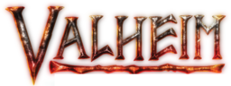

# valheim-gamestats

[](https://github.com/xx4h/valheim-gamestats/actions/workflows/ci.yml)
[](https://github.com/xx4h/valheim-gamestats/releases)
[](LICENSE)

*An unofficial fan project — not affiliated with or endorsed by Iron Gate Studio. Valheim and its logo are trademarks of
Iron Gate AB.*

<p align="center"></p>

<p align="center"><b><a href="https://xx4h.github.io/valheim-gamestats/">See the demo →</a></b> — seven made-up Vikings, ~350 in-game days</p>

Stats pages for Valheim dedicated servers: sessions, deaths, raids, exploration, combat, gathering, the world save
(base, chests, pets, portals, dungeons), titles and a Discord feed — one page per server, from

- a **BepInEx plugin** on the server (`plugin/`) that records what happens — sessions, deaths, combat, gathering,
  movement, who discovered a zone, raids, … — in its own event store on the server, fetched over RCON,
- its **world save** and the plugin's terrain sample, read through the Pelican client API, a local directory or a
  script (optional),
- live state over RCON (positions, gear, the world clock) and Steam achievements (optional).

Nothing comes from the game server's log.

| Part | What | Where |
|---|---|---|
| collector | Python (stdlib only); fetches the plugin's events into SQLite, reads the save and RCON; writes each server's data for the page; posts to Discord | `collector/`, image `collector` |
| web | the static page (`site/`) behind nginx | image `web` |

The page gets its data in pieces (`collector/valheim_gamestats/chunks.py`): `index.json` names the files that make it up, each named by
its content and cached by the browser for good — history by month, week and day, the parts of the state that change on
their own clock (world and pets with the hourly save, custody with gear moves, Steam with its checks) and a small
`live` one that changes every minute. An open page polls `index.json` and fetches only
new names: a few KB a minute instead of the whole history.
| plugin | BepInEx plugin `ValheimGamestats.dll` (events in its own store on the server, ValheimRcon commands) | `plugin/`, package `plugin/<version>` |
| chart | Helm chart for both, configured per server | `chart/valheim-gamestats` |

Who gets credit for what is a rule, written down in [docs/ATTRIBUTION.md](docs/ATTRIBUTION.md), each with a test.
How much it counts — the impact score's weights, which titles exist and what they take, badge steps, card yardsticks,
milestones — is each server owner's choice: [docs/SCORING.md](docs/SCORING.md), with the math. The page shows the rules in
force under Players → Scoring.

**Docs:** [how it works](docs/DESIGN.md) · [deploying the plugin](docs/PLUGIN-DEPLOYMENT.md) ·
[running it without Kubernetes](docs/MANUAL-DEPLOYMENT.md) · [working on it](AGENTS.md) ·
[who gets credit](docs/ATTRIBUTION.md) · [what counts how much](docs/SCORING.md) · [the event contract](docs/events.json)

## Install

The chart takes everything specific to a setup as values; nothing is built in. One release can serve several
servers (each its own hosts):

```yaml
servers:
  - id: my-valheim
    title: My Valheim
    hosts: [stats.example.com]
    rcon:
      host: valheim-0.game.svc.cluster.local   # ValheimRcon; the plugin's events come through it
secrets:
  existingSecret: valheim-gamestats   # api_key, steam_api_key, <id>-rcon, <id>-discord-webhook — all optional
ingresses:
  - name: web
    className: traefik
    tls: true
```

See `chart/valheim-gamestats/values.yaml` for the rest: the world save (Pelican, local or script), Steam, Discord, maintenance
windows, a support link, scoring ([docs/SCORING.md](docs/SCORING.md)), persistence, pod labels.

The plugin goes onto the game server with `plugin/deploy.sh` (never over the loaded file — see
[docs/PLUGIN-DEPLOYMENT.md](docs/PLUGIN-DEPLOYMENT.md)). Without Kubernetes: [docs/MANUAL-DEPLOYMENT.md](docs/MANUAL-DEPLOYMENT.md).

## Alerts

A broken plugin doesn't fail loudly: the numbers just stop growing. Every collector run checks for what should be
there and isn't (`collector/valheim_gamestats/health.py`) and posts to an admins' Discord webhook (secret key `alerts-discord-webhook`;
without it the alerts are only logged):

| Alert | Means |
|---|---|
| `error:<area>` | the plugin warned — `zero rva`: its DLL was overwritten while loaded, restart; `patch`: a game update broke a hook; `copies`: the old `GamestatsEquipment.dll` is loaded too |
| `noplugin` | players online but the plugin didn't start with the server, or the server doesn't know `gs_events` |
| `silent` | a player online for 10 min without a single plugin event |
| `quiet:combat`, `quiet:gathering`, `quiet:movement` | hours of play without one such event |
| `version` | the server runs another plugin major.minor than the release ships (patch releases need no new plugin) |
| `rcon` | RCON can't be reached; the events came from the store's files (the file source) |
| `gap` | numbers missing in the plugin's store: exactly that many events are lost |
| `store` | the plugin's store was replaced (numbers start over) or has fewer events than were read |
| `crash:<time>` | the server came back without a clean stop |
| `hooks` | the plugin started with hooks missing (its start event says which); their stats stay empty |
| `heartbeat` | no per-minute server sample from the plugin: its timers stopped |
| `unjoinable` | the server runs, but its crossplay (PlayFab) session isn't active 3 min after the start, or PlayFab failed: nobody can join until a restart |
| `missed:login`, `missed:logout` | ValheimRcon's own player list disagrees with the plugin's sessions |
| `missed:death` | more new tombstones (the game's own record of a death) than death events |
| `missed:zones` | the world save has more newly generated zones than the plugin reported between two saves |
| `collector:<step>` | fetching the events, the world save, Steam, RCON or posting failed |
| `duplicate`, `zones` | only for history from the log (two plugin starts in a boot; zones without the plugin's zone line) |

The `missed:*` checks compare the plugin with what it doesn't write itself — so a plugin that quietly stops
recording one kind of event is noticed, not only one that stops altogether. Kills and damage have no such second
source on a server (player profiles live on the clients); the `quiet:*` checks cover them.

An alert goes out after three runs in a row (plugin warnings, gaps, store changes and crashes at once), again every
6 h while it lasts, and once more when it's resolved. Replayed over the first server's whole history, the only
alerts were the real incidents.

## Releases

One version for chart, images and plugin: `version`/`appVersion` in `chart/valheim-gamestats/Chart.yaml` and
`Version` in `plugin/Plugin.cs` (it continues the plugin's numbering, which the collector compares against). When it
changes on `main` and every job passed (tests, site checks, plugin build, images), CI tags the images and the plugin
with it and creates the release `vX.Y.Z` with its tag: images on `ghcr.io/xx4h/valheim-gamestats/{collector,web}`, the
plugin attached to the [release](https://github.com/xx4h/valheim-gamestats/releases). Deployments follow those tags
(e.g. a Flux `GitRepository` with a semver range), so nothing untested is ever picked up.

## Development

    python3 -m unittest discover -s tests/collector -v      # the collector (valheim_gamestats), no dependencies
    ruff check --config collector/pyproject.toml collector tests/collector tools demo
    cd tests/site && npm ci && npx playwright test          # the page in Chromium, desktop and phone
    tests/chart/check.sh                                    # helm lint + rendered config
    cd tests/plugin && dotnet run                           # event store, combat rules, every hook against the game (after a plugin build)
    cd tests/plugin && dotnet run -- replay <trace.jsonl>   # a recorded session (Debug/Trace) through today's combat rules

- [docs/events.json](docs/events.json) is the contract: every event the plugin sends, what it becomes, which stat
  shows it, and every `data.json` key — each with the tests that cover it. `test_contract.py` scans the plugin's
  code and fails on an event that isn't listed, an entry without tests, or a listed test that isn't about it;
  `test_build.py` runs the whole collector with every source (save, terrain, RCON, Steam) and fails on a key
  that's missing, empty or not in the contract.
- `tests/collector/` builds logs line by line (`logs.py`) and checks each rule of
  [docs/ATTRIBUTION.md](docs/ATTRIBUTION.md); `test_golden.py` runs the whole collector on a made-up two days and
  compares the result with `golden/data.json` — `UPDATE_GOLDEN=1` rewrites it, review the diff.
- `tests/site/` crawls every page the overview links to and fails on any script error, and checks numbers that went
  wrong before. Its `fixture/data.json` is a real server's, anonymized with `tests/site/anonymize.py`.
- CI (`.github/workflows/ci.yml`) runs all three, builds the plugin against the current public Valheim dedicated
  server (SteamCMD, `plugin/fetch-refs.sh`), runs `tests/plugin` and builds both images.

`tools/` has the one-off extractors for the game's item icons and player looks (`tools/README.md`).

The demo (`demo/generate.py`) plays a made-up server through the real collector: seven Vikings, ~350 in-game days,
seeded, so the same history every time. `.github/workflows/pages.yml` publishes it to GitHub Pages daily (its history
ends today), with the game's icons and player figures extracted from the dedicated server on the way
(`--gamedata`); `test_demo.py` keeps it working; `demo/showcase.sh` records the animation above from it there (it lives on Pages, not in the repository).

## License

The code is [MIT](LICENSE). The Valheim logo and the favicons made from it are Iron Gate's, from their
[press kit](https://www.valheimgame.com/press/), and not covered by the MIT license — see [NOTICE](NOTICE). This project
ships none of the game's files: CI fetches what the plugin builds against from the public dedicated server, and the
demo's icons and figures are extracted from it when Pages is built.
